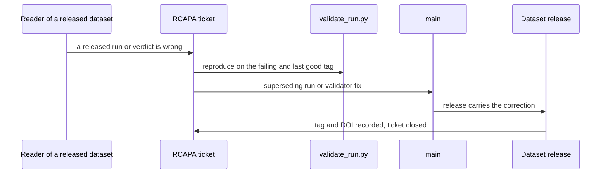

# RCAPA: regressions in a release of swarm-routing/benchmarks

An **RCAPA** (root cause analysis with corrective and preventive actions) is
the full record of one **regression in a published release** of this
project: something that worked in a released version and broke after a
change. A bug or change that never reached a release needs none (an
ordinary `bug` issue is enough), and an upstream ns-3 bug is an `NS3-NNN` in
swarm-routing/ns3-tools. The org's rule and its decision table are in
[CONTRIBUTING.md, "RCAPA"](https://github.com/swarm-routing/.github/blob/main/CONTRIBUTING.md#rcapa)
([ADR-0003](https://github.com/swarm-routing/.github/blob/main/docs/adr/0003-rcapa-for-ns3-bugs-and-released-regressions.md)).
This page is the project's flow and its index.

## The flow for this project

A **published release** of benchmarks is a `v*` tag: its GitHub release
with the dataset tarball `benchmarks-<ver>.tar.gz` (`tools/release/dist.sh`),
archived on Zenodo as a dataset (concept DOI
[10.5281/zenodo.24145189](https://doi.org/10.5281/zenodo.24145189)). A
regression is a released dataset or validator that is wrong where the release
before it was right: a run that validated and no longer does, a manifest that
names the wrong digest or commit, a verdict that does not recompute. Merged
runs are immutable (golden rule 10), so the correction is a new run that
names the one it supersedes, never an edit. A defect caught before the next
tag needs no RCAPA.

| | |
|---|---|
| Published as | `v*` tags: GitHub release (`benchmarks-<ver>.tar.gz`) + Zenodo dataset DOI |
| ID prefix | `BEN-NNN` |
| Ticket | an issue in swarm-routing/benchmarks, form *Regression in a release (RCAPA)*, title `[rcapa] BEN-NNN <short description>`, labels `rcapa` and `bug` |
| Verified by | `python3 -I tools/validate_run.py check runs/<dir>` (and `all`) at the failing tag and the last good one; the verdict recomputed with ns3-tools' readers (golden rule 12) |
| Corrective action | a new run that supersedes the wrong one (golden rule 10), or a validator fix with a fixture in its self-test; then a release |
| Preventive action | a validator check or self-test fixture that rejects the defect, so `runs.yml` refuses it on the PR |
| Closes when | the correction is merged **and** a `v*` release carries it (tag and version DOI read from Zenodo) |

## Index

| ID | RCAPA | RCAPA ticket | Fixed in |
|----|-------|--------------|----------|

## Adding one: the ticket first

1. Open the RCAPA ticket (the table above). `NNN` is the next free number in
   the index.
2. Copy [`_template.md`](_template.md) to `rcapa-<short-description>.md`
   (lowercase, hyphens: what breaks, not where it was found), and add its row
   to the index in the same pull request.
3. The ticket stays open until the corrective action is merged **and a
   release carries the fix**; record that release in the index.

## What an RCAPA answers

1. **What broke, in which release, and who did it touch?** The symptom, the
   releases that fail and the last that passes, the users, numbers or
   downstream pins it affects.
2. **How do I see it myself?** Exact commands, the release or commit, an
   image by tag and digest when one is involved, seeds, expected against
   actual.
3. **Why did it happen, and why did our checks let it into a release?** Five
   whys, each citing its evidence: a source line at a named commit, a log, a
   run, a comment. An answer without a source is a hypothesis and says so.
4. **What does it look like?** Mermaid diagrams: the failing call chain, the
   types or components involved.
5. **What did we do about it?** Corrective actions (the fix, its PR, the
   release that carries it) and preventive actions (the test or check that
   catches a recurrence). An action not done yet is an open issue, linked.
6. **When?** A dated timeline and every link.

## Writing one

- Every issue and PR reference is fully qualified: `swarm-routing/<repo>#N`,
  also for this repository's own items; an ns-3 item is a link whose text is
  `nsnam/ns-3-dev#N` to its full gitlab.com URL. Never a bare number with a
  hash. In a mermaid block, which cannot hold a hash, name the item in words.
- Mermaid: no HTML entities inside a block; write template arguments as
  words.
- An RCAPA is never deleted. Later findings update its status and timeline.
